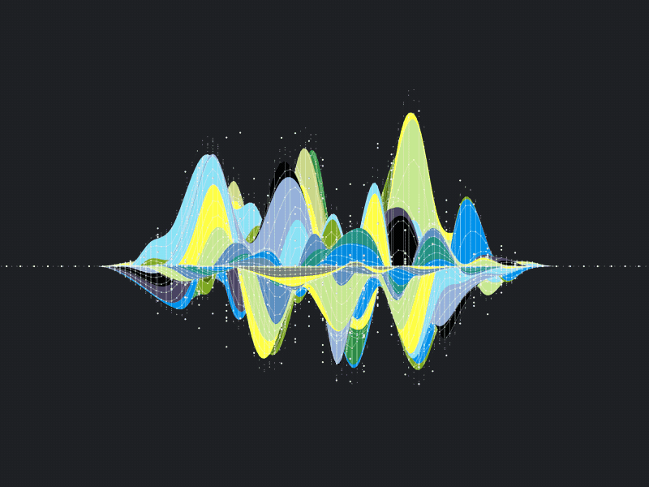

<!-- ========================================= -->
<!-- PROFILE HEADER                            -->
<!-- ========================================= -->

<p align="center">
  
</p>

&nbsp;

<!-- ========================================= -->
<!-- PROGRAMMING LANGUAGES                     -->
<!-- ========================================= -->

<p align="center">
  
  
  
  
</p>

&nbsp;

<!-- ========================================= -->
<!-- BIO                                       -->
<!-- ========================================= -->

```bash
# Computational Chemist with some Data Science flavor.
```

